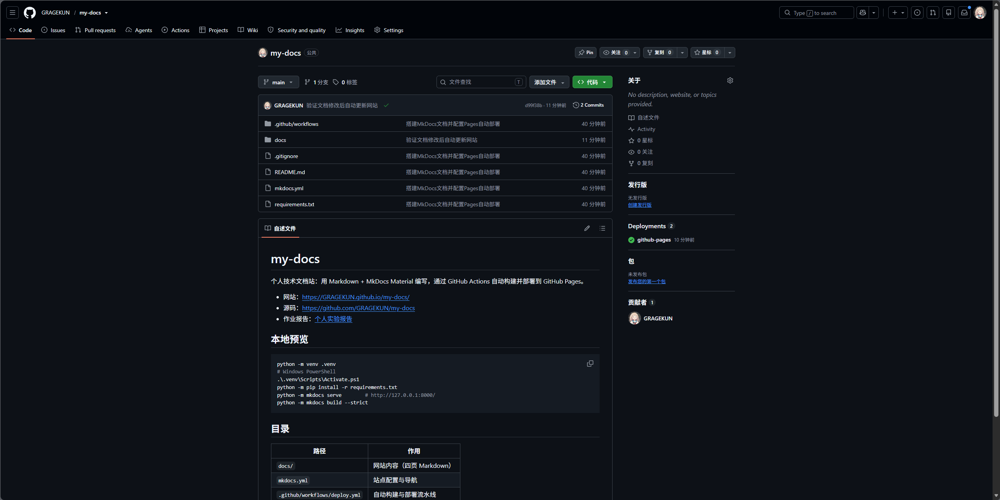
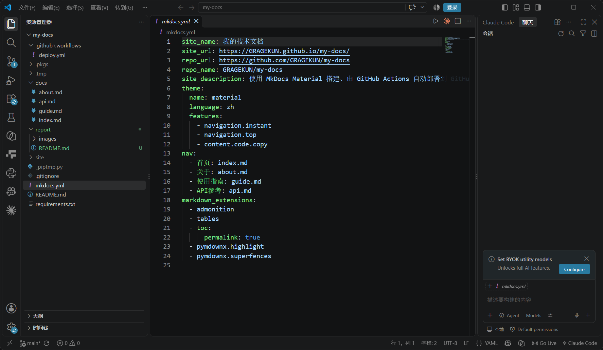
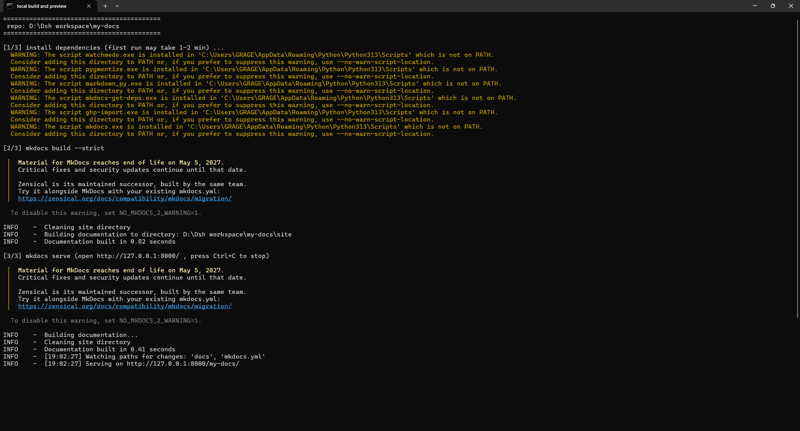
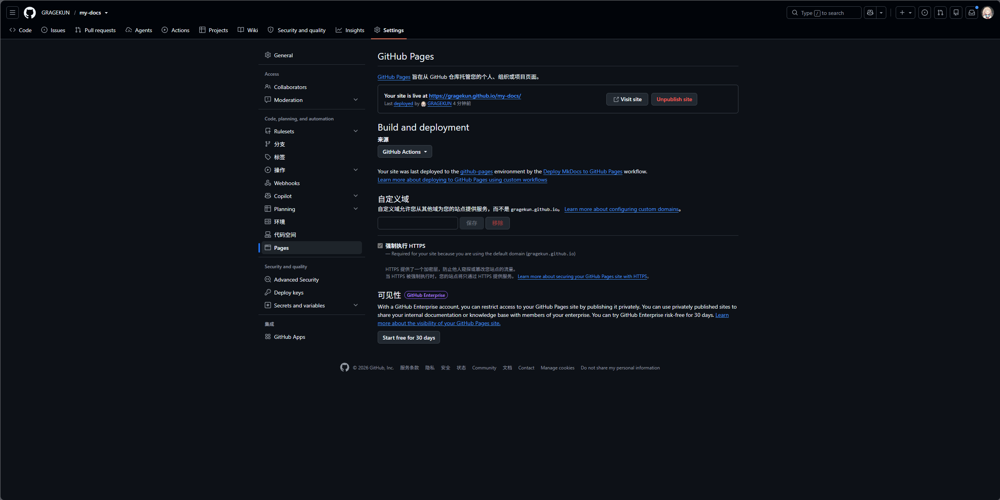
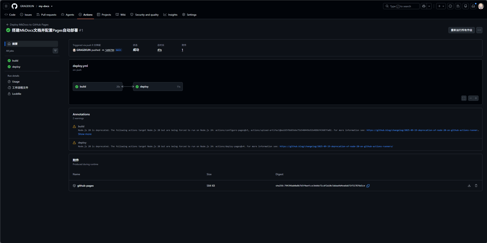
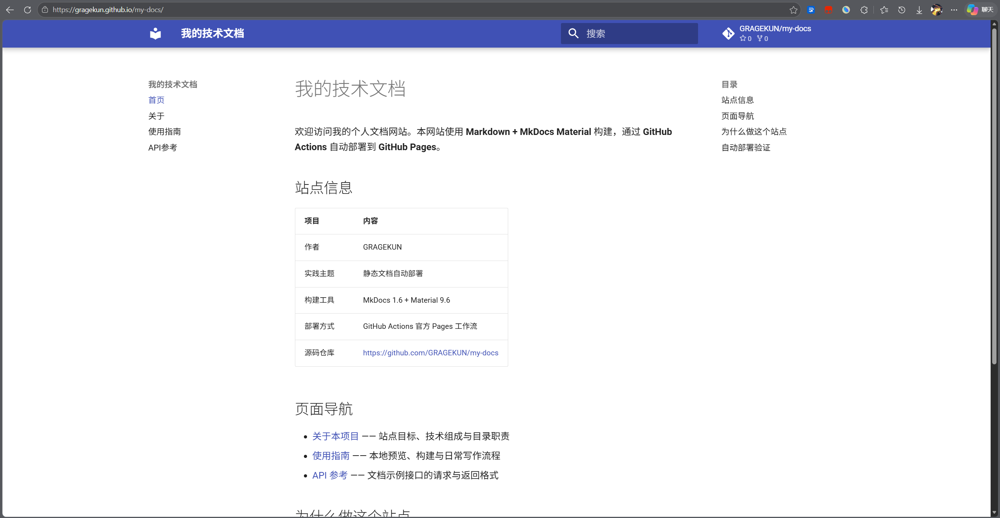
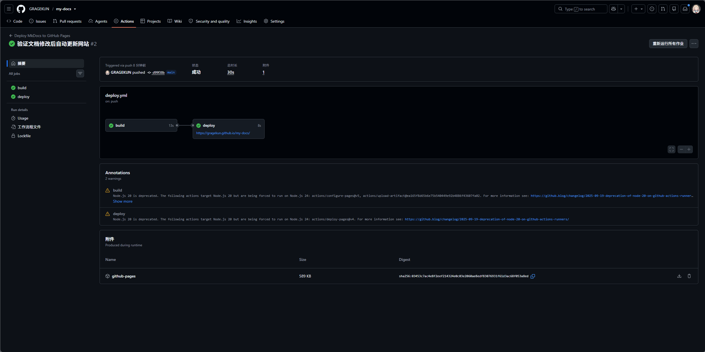
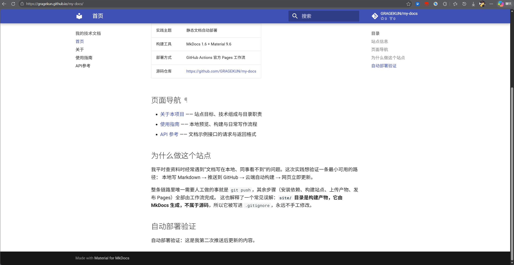

# 实践项目2：个人实验报告

## 1. 基本信息

- GitHub 登录名：GRAGEKUN
- 个人仓库地址：<https://github.com/GRAGEKUN/my-docs>
- 最终网站地址：<https://GRAGEKUN.github.io/my-docs/>

## 2. 实践过程与关键截图

> 截图放在 `report/images/`，用相对路径引用。下表是我每一步做了什么、为什么这样做、结果是什么。

### 2.1 仓库创建

在 GitHub 点 `+` → `New repository`，Owner 选本人账号，仓库名 `my-docs`，可见性选 **Public**（Pages 免费站点需要公开仓库），勾选 README 初始化，确认默认分支为 `main`。然后用 `git clone` 把仓库拉到本地。

- 为什么：公开仓库 + `main` 分支是后文工作流 `on.push.branches: [main]` 能触发的前提。
- 结果：仓库创建成功，本地 `git branch --show-current` 输出 `main`。



### 2.2 项目结构与 MkDocs 配置

按作业给定的结构创建 `docs/`（四页）、`mkdocs.yml`、`requirements.txt`、`.gitignore`、`.github/workflows/deploy.yml`、`report/`。

- `docs/`：网站内容的唯一来源，四个页面分别在 `index.md`、`about.md`、`guide.md`、`api.md`。
- `nav`：写在 `mkdocs.yml` 里，路径相对 `docs/`，所以是 `index.md` 而不是 `docs/index.md`。
- `site/`：`mkdocs build` 生成的产品目录，写进 `.gitignore`，不提交、不手改。
- `site_url` 必须带仓库路径 `/my-docs/`，否则 Pages 上的 CSS/JS 会 404。



### 2.3 本地构建或预览

```bash
python -m venv .venv
.\.venv\Scripts\Activate.ps1
python -m pip install -r requirements.txt
python -m mkdocs build --strict
python -m mkdocs serve
```

本地检查了四项：导航四个入口都能点开；表格渲染正常；代码块高亮正常；页面内相互链接（`index.md → about.md` 等）都能跳转。

- 为什么用 `--strict`：把链接失效、导航指向缺失文件这类警告升级为构建失败，保证 CI 不会发布一个坏站点。
- 结果：`INFO - Documentation built in ... seconds`，退出码 0。



### 2.4 Pages 设置

`Settings` → `Pages` → `Build and deployment` → `Source` 选择 **GitHub Actions**。

- 为什么：本次使用官方 Pages Actions 工作流，用 artifact 直接发布，不创建 `gh-pages` 分支，也不需要 PR 审核权限。
- 结果：页面提示发布来源已设为 GitHub Actions。



### 2.5 Actions 首次构建和部署

推送后打开 `Actions` → `Deploy MkDocs to GitHub Pages`，`build` 与 `deploy` 两个任务都是绿色对勾。`build` 完成了检出源码、配置 Python 3.12、安装依赖、`mkdocs build --strict`、上传 `site/`；`deploy` 在 `needs: build` 之后把 artifact 发布到 `github-pages` 环境。

- 结果：工作流运行成功（#1，耗时 41s，`build` 20s、`deploy` 11s），部署记录给出了站点地址。
- 首次运行链接：<https://github.com/GRAGEKUN/my-docs/actions/runs/45158885007>



### 2.6 网站访问与四页导航检查

打开 `https://GRAGEKUN.github.io/my-docs/`，逐一访问首页、关于、使用指南、API 参考。

- 检查内容：地址栏是带 `/my-docs/` 的项目站点地址；四页导航都能正常切换；表格、代码块样式已加载（说明 `site_url` 配置正确）；页脚与仓库链接可用。



### 2.7 第二次推送与自动更新验证

在 `docs/index.md` 里加了一句可辨认的话：“自动部署验证：这是我第二次推送后更新的内容。”然后提交推送，**没有点手动运行**，观察新一次运行被 push 自动触发。

```bash
git add docs/index.md
git commit -m "验证文档修改后自动更新网站"
git push origin main
```

刷新网站后新文字出现（必要时用无痕窗口排除缓存）。

- 对应提交链接：<https://github.com/GRAGEKUN/my-docs/commit/d99f38bbf9d8410f78bb49ce778573a11250e9d8>
- 对应 Actions 运行链接：<https://github.com/GRAGEKUN/my-docs/actions/runs/45159430360>（#2，`d99f38b`，success，`build` 13s、`deploy` 8s）

第二次运行的记录（`build`、`deploy` 均成功，deploy 节点上直接显示站点地址）：



刷新网站后，「自动部署验证」小节和新句子已经出现（地址栏仍是 `https://Gragekun.github.io/my-docs/`）：



## 3. 问题与解决

| 现象 | 原因 | 解决 |
| --- | --- | --- |
| 浏览器和 git 都打不开 `github.com`，Actions 里也看不到工作流 | 本机一个游戏加速工具把 `github.com` 解析到了 `127.0.0.1`，本机又没有可用代理，连接被劫持到死路 | 退出该加速工具后 `git ls-remote` 恢复正常，再推送就成功了；教训是：先确认能连通再排查其它 |
| `git push` 报 `schannel: AcquireCredentialsHandle failed: SEC_E_NO_CREDENTIALS` | Windows schannel 在受限进程里拿不到证书凭据，HTTPS 握手失败 | 给仓库单独设置 `git config http.sslBackend openssl`，改用 OpenSSL 后端后握手正常 |
| 第一次推送后 Actions 里看不到任何运行 | 仓库当时还是空的（提交没推上去），工作流文件根本不在远端 | 重新确认 `git log` 和远端状态后再次推送，`deploy.yml` 上传后工作流才出现在 Actions 里 |
| `python -m venv .venv` / `pip install` 卡住或写入被拒 | 依赖安装过程需要写系统临时目录，当前受限环境没有写权限 | 把下载和构建挪到项目目录内的临时路径，或直接用 `pip install --user` 装到用户目录 |
| 本地 `mkdocs serve` 的地址是 `http://127.0.0.1:8000/my-docs/` 而不是根路径 | `site_url` 带了仓库路径，本地预览沿用该子路径 | 属于正常现象，直接访问带 `/my-docs/` 的地址即可，和线上路径保持一致反而更真实 |

没有遇到的报错也核对了日志：`build` 中 `mkdocs build --strict` 退出码为 0，只有 `node20` 弃用告警（不影响结果）；`deploy` 输出了 `page_url`；`Settings → Pages` 的来源始终是 GitHub Actions，没有混用分支发布。

## 4. 原理理解

1. **`docs/` 和 `site/` 各保存什么？为什么不用手工修改 `site/`？**
   `docs/` 是手写的 Markdown 源码，是内容的唯一来源；`site/` 是 `mkdocs build` 根据源码和主题生成的静态 HTML/CSS/JS。`site/` 属于产物，每次构建都会被清空重建，手改会在下次构建时被覆盖，所以它被 `.gitignore` 忽略，由 CI 现场生成。

2. **本次工作流在什么情况下自动运行？**
   `push` 到 `main` 且改动命中 `docs/**`、`mkdocs.yml`、`requirements.txt`、`.github/workflows/deploy.yml` 之一时自动运行；另外 `workflow_dispatch` 允许在 Actions 页面手动触发。

3. **`build` 与 `deploy` 两个任务有什么区别？**
   `build` 只读源码：检出、装 Python、装依赖、构建、上传 artifact，权限是 `contents: read`；`deploy` 消费 artifact，需要 `pages: write` 和 `id-token: write` 才能发布到 Pages 环境，并通过 `needs: build` 保证构建成功后才发布。拆成两个任务的目的是最小权限和失败隔离。

4. **只修改 `report/README.md` 会触发部署吗？为什么？**
   不会。`paths` 过滤里没有 `report/**`，这次推送不会创建工作流运行；报告变化不影响网站内容，因此不需要重新构建发布。

5. **本次方案为何无需创建 `gh-pages` 分支？**
   因为用的是官方 Pages Actions：`upload-pages-artifact` 把 `site/` 打包成 artifact，`deploy-pages` 直接把它发布到 Pages 托管环境。产物不再需要提交到某个分支，也就不需要维护 `gh-pages` 分支或 `ghp-import` 推送。
